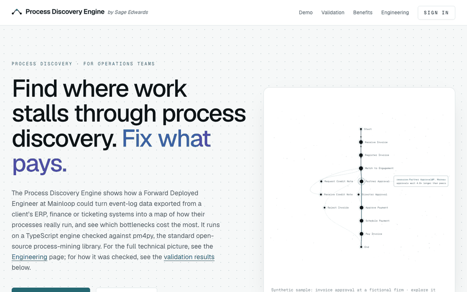
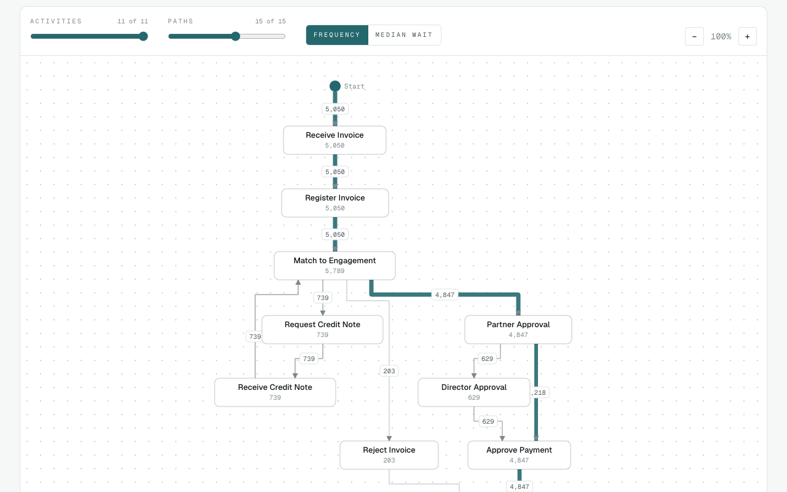
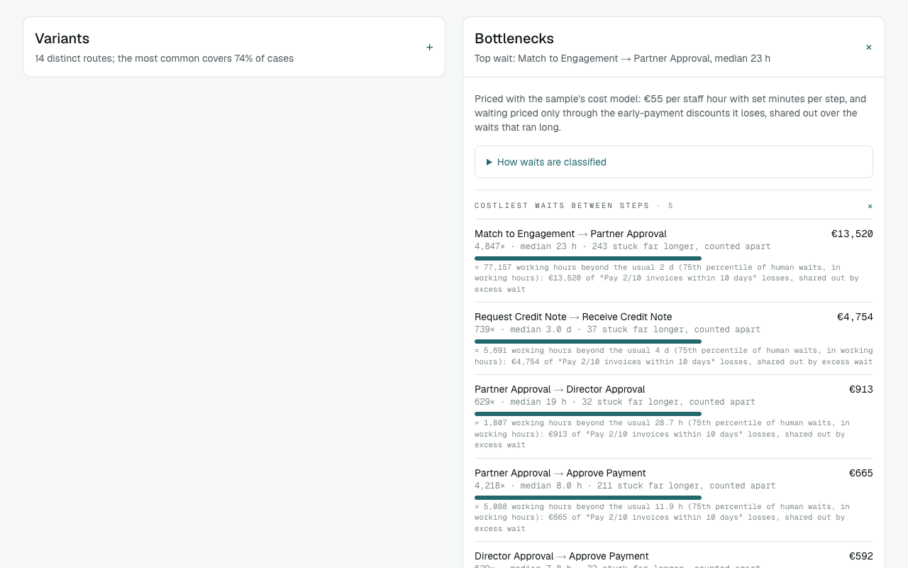
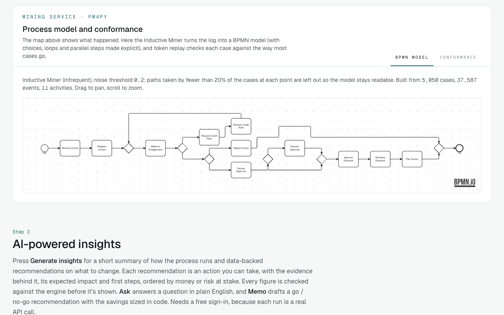
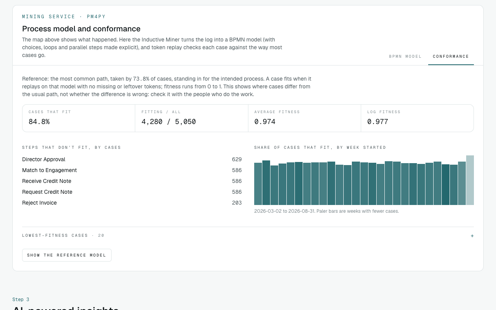
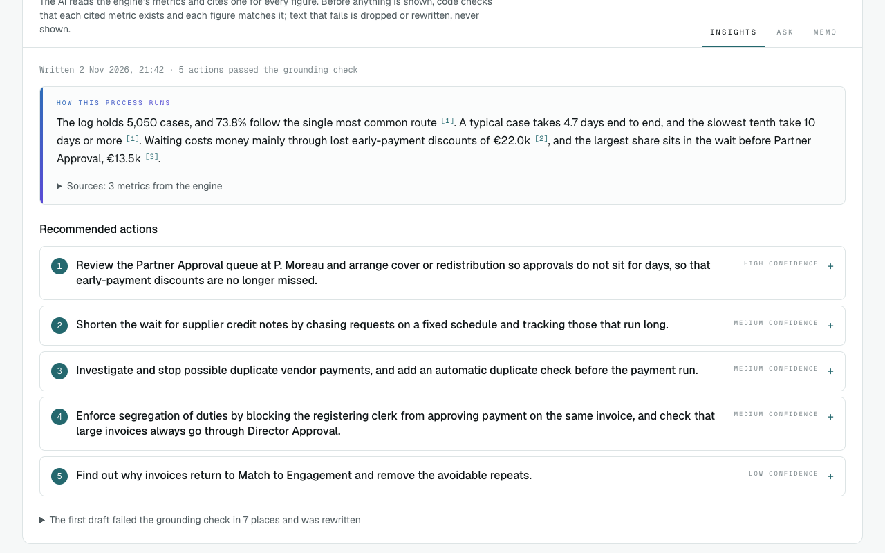
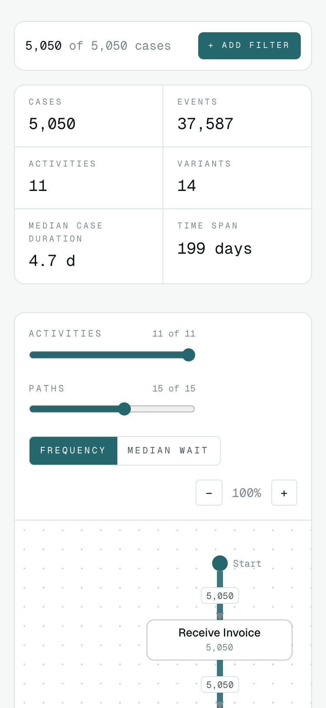

# Process Discovery Engine

**Process discovery for operations and finance teams.** Upload an event log exported from an ERP, ticketing or
finance system (CSV, Excel or XES) and see how work actually flows: the common path and every variant, where cases
wait, which business rules are broken, what it costs, a BPMN model with conformance, and AI-written recommendations
whose every figure is checked by code before it's shown.

> A portfolio project by Sage Edwards (Brown University), built around a Forward Deployed Engineer's loop: discover,
> size, prototype, go / no-go. Codename **Throughline** (the `@throughline/*` packages). Independent; not affiliated
> with or endorsed by Mainloop or Leyton.

**Live demo:** _link added at deploy_ · two public demos, no account needed: `/sample` (BPI Challenge 2020, real
travel-expense data) and `/sample/meridian` (a synthetic invoice-approval log with known, injected problems).



| | |
|---|---|
| **Discover** | Process map (directly-follows graph) with activity and path sliders, frequency or median-wait view; variants; filters by time, attribute, activity or variant |
| **Diagnose** | Bottlenecks ranked by cost, with waits classified (queue, nights, batch runs, planned dates, automatic steps); people slower than peers; rework; root causes with n, lift and small-sample flags |
| **Comply** | Business rules a controller recognises (precedence, four-eyes, thresholds, SLAs, duplicates), each violation priced with its formula |
| **Model** | Inductive Miner BPMN model and token-replay conformance from a pm4py service |
| **Decide** | AI insights, an "ask your process" agent and a go / no-go memo; savings sized in code, every cited figure verified |

## Screenshots

| Explorer | Bottlenecks |
|---|---|
|  |  |
| **BPMN model** | **Conformance** |
|  |  |
| **Grounded insights** | **Phone (375 px)** |
|  |  |

## Getting started

Prerequisites: Node ≥ 22.12, Docker (on macOS, Colima works: `colima start --cpu 4 --memory 8`), and Python 3.12 with
[uv](https://docs.astral.sh/uv/) for the mining service.

```bash
npm install
npm run db:start                              # local Supabase (Postgres, Auth, Storage); Mailpit at :54324
cp src/web/.env.example src/web/.env.local    # local values; add ANTHROPIC_API_KEY for live AI
npm run dev                                   # http://localhost:3000; sign-in emails land in Mailpit
```

The mining service (XES upload, BPMN and conformance on uploaded datasets):

```bash
cd src/miner
SUPABASE_URL=http://127.0.0.1:54321 ALLOW_HTTP_URLS=1 EVENTS_URL_ALLOWED_HOSTS=127.0.0.1 \
  uv run uvicorn --factory throughline_miner.main:create_app --port 8010
```

then set `MINER_URL=http://127.0.0.1:8010` in `src/web/.env.local`.

### Tests

```bash
npm test             # engine, synthetic-data ground truth, web (grounding, pipelines, limits)
npm run typecheck && npm run lint
npm run db:test      # pgTAP: row-level security and AI usage limits
npm run e2e          # Playwright: sign in, upload, map, filter, bottleneck, XES, BPMN, insights, phone width
cd src/miner && uv run pytest -q
```

CI runs all of them on every push and pull request, plus a Docker build of the mining service.

## Architecture

```
Browser ─ upload (CSV/Excel parsed here) ─ explorer UI ◄─► Web Worker (engine) ─┐
   │ fetch                                                                        │ supabase-js under RLS
   ▼                                                                              ▼
Next.js 16 (Vercel) ── /api/ai/* ──► Claude API          Supabase: Postgres (RLS), Auth (magic links), Storage
   │                ── /api/miner/*, /api/import/xes ──► Miner (FastAPI + pm4py, Fly.io) ◄─ signed URLs ─┘
   └── lib/analysis/analyse.ts: the same engine figures for the explorer and the AI
```

| Part | Where | What |
|---|---|---|
| Engine | `src/engine` | Pure TypeScript process mining (no I/O): ingest, DFG, variants, filters, waits, cost, rules, root causes. Runs in a Web Worker and on the server |
| Web app | `src/web` | Next.js 16 (App Router, `cacheComponents`), Tailwind 4; sign-in, upload, explorer, settings, AI routes |
| Miner | `src/miner` | Python FastAPI + pm4py: Inductive Miner → BPMN, token replay, XES import |
| Database | `supabase/` | Migrations, row-level security on every table, storage policies, pgTAP tests |
| Synthetic data | `src/datagen` | The Meridian invoice log with injected problems and the ground truth the tests check |

Key choices, each with an ADR in [`docs/adr/`](docs/adr):
- **Hybrid engine** (0001): interactive mining in TypeScript in the browser; heavy algorithms in pm4py.
- **Cost model** (0002): every currency figure comes from an editable cost model and shows its formula; waiting is
  priced only through its consequences (missed discounts, late fees, capital), never as labour.
- **Wait classification** (0003): only working-hours queue time beyond the usual counts as excess.
- **pm4py licence** (0004): pm4py is AGPL-3.0; the mining service's source is offered through the Source link.
- **Grounding** (0005): the AI cites a metric ID for every figure; code checks each one exists and matches before
  anything is shown.

More: [`ARCHITECTURE.md`](ARCHITECTURE.md) (data flow, routes, env vars), [`DESIGN.md`](DESIGN.md) (visual and copy
rules), [`docs/validation.md`](docs/validation.md) (results on BPI Challenge 2017–2020 against published analyses).

## Documents

| Document | For |
|---|---|
| [`docs/build-plan.md`](docs/build-plan.md) | Plan, milestones and current status |
| [`docs/deployment-plan.md`](docs/deployment-plan.md) | Hosting, environments, secrets, backups, rollback, cost |
| [`docs/handover-pack.md`](docs/handover-pack.md) | Run, operate, extend, known limits |
| [`docs/market-comparison.md`](docs/market-comparison.md) | Where it sits next to Celonis, Signavio, ARIS, Power Automate, Disco and pm4py |
| [`docs/validation.md`](docs/validation.md) | Evidence on real public logs |

## Status

M0–M5 are done (engine, data in, explorer, real-data validation, grounded AI). M6 (ship) is deployment-ready: security
headers, one upload limit, BPMN and conformance views, end-to-end tests, CI, backups and these documents. The hosted
deploy is next. See the Status section of [`docs/build-plan.md`](docs/build-plan.md).

## Licence

[MIT](LICENSE) © 2026 Sage Edwards. The mining service depends on [pm4py](https://github.com/process-intelligence-solutions/pm4py),
which is AGPL-3.0, so a deployed miner carries AGPL obligations (its source is offered with the rest of this
repository; see [ADR 0004](docs/adr/0004-pm4py-licence.md)). The BPI Challenge 2020 demo snapshot in
`src/web/public/demo/` is CC BY-NC 4.0 (B.F. van Dongen, 4TU.ResearchData). bpmn-js is used under the bpmn.io licence,
which keeps its watermark visible.
